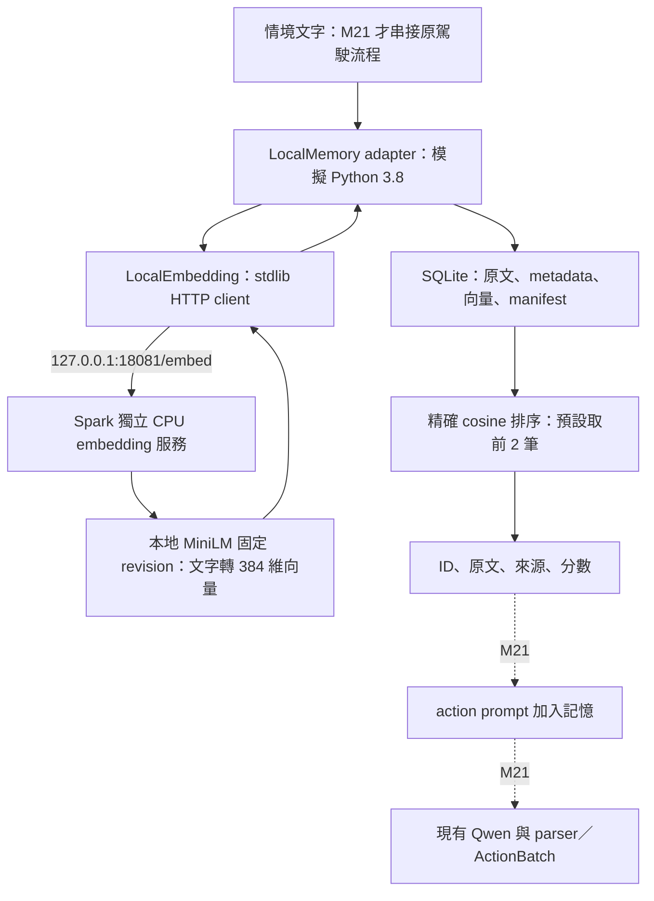

# M20 概念、架構與操作邊界

2026-11-25 更新：下文是第一版 SQLite 架構，保留歷史。正式方向已改為 MiniLM＋Chroma，SQLite 僅為測試參考；最新架構及 Spark 驗收命令見 [M20-R1](./R1-chroma/report.md)。

## 記憶在這裡代表什麼

這是一個外部經驗資料庫。embedding 將英文情境轉成 384 個數字，讓相似文字可透過向量角度比較；它不決定通行權、不修改 Qwen 權重，也不保證數字接近的情境必然具備相同安全條件。Qwen 讀到檢索出的文字範例後，才產生動作；最後仍須通過原 parser 與車輛動作檢查。

## 架構



Qwen 與 MiniLM 是兩個不同用途的模型：Qwen 產生決策，MiniLM 只編碼文字。M20 不啟動 Qwen；embedding 服務也不接觸 env.step。SQLite 是一般資料庫，並不內建理解交通的能力。

## 寫入與檢索

寫入：呼叫者提供穩定 ID、情境文字及來源 metadata → embedding client 向本地服務發送文字與 manifest → 服務確認相符及 token 長度 → CPU 編碼／mean pooling／L2 正規化 → client 驗證回覆 → SQLite 一次交易存入。重複 ID／無來源／壞向量／唯讀庫明確報錯。M20 僅提供工具，何時寫入、哪些回合可寫入由 M22 定義。

檢索：query 文字 → 同一模型與相同處理方式編碼 → 讀出庫中向量 → 計算 cosine → 分數降序、同分依 ID → 回傳 top-k 的原文、來源與分數。這個分數表示向量相似程度，不是安全率、成功率或碰撞風險。沒有設相似度篩選門檻；空庫回傳空清單。

## 與原程式比較

| 項目 | 原設計 | M20 |
|---|---|---|
| embedding 執行位置 | OpenAI 雲端 API | Spark CPU 本地服務 |
| 文字會送去哪裡 | 雲端 embedding endpoint | 僅 127.0.0.1；無雲端 fallback |
| 模型設定 | 建構 OpenAIEmbeddings，未明確固定 revision | MiniLM 固定 revision、384 維、pooling／正規化／長度政策 |
| 儲存位置 | Chroma，本身已是本地持久化庫；./db/<環境> 相對路徑 | 獨立 SQLite 絕對路徑，限個人目錄；不接舊 Chroma |
| 模擬環境依賴 | LangChain、Chroma、OpenAI embedding 相依 | stdlib HTTP／SQLite；ML 相依在服務環境 |
| 檢索 | Chroma similarity_search_with_score，呼叫端丟掉分數 | 全庫精確 cosine，保留 ID、原文、metadata、分數 |
| query | 原 action helper 用 prompt 最後兩行 | M20 由呼叫者明確提供文字；M21 才統一版本化擷取 |
| 資料相容性 | 未看到明確 embedding manifest 檢查 | client／service／DB manifest 不一致即停止 |
| 更新 | 原註解程式在步進前寫入，評語來自規則 | M20 提供 add，尚不自動更新；M22 才接步後流程 |
| 啟用狀態 | 原檢索／更新被註解，現行 off 返回 None | 正式路徑仍 off，尚不注入 prompt |

原版不是把記憶資料庫存在雲端：雲端的是 embedding 計算，Chroma 儲存仍在本地。更換模型後，舊向量不可直接搬過來比較，必須先核對來源，再用新模型重新編碼原文字；M20 沒有自動搬資料。

## Spark 下一步：先做不載入模型的驗證

以下由使用者在 Spark repo 根目錄手動執行。只使用既有模擬環境與人工向量，不下載／載入任何模型，不啟動 Qwen，不執行交通 seeds。

```bash
cd /home/nclab/Yizhen/src/CoDrivingLLM-Thesis
PYTHONDONTWRITEBYTECODE=1 TMPDIR=/home/nclab/Yizhen/runs /home/nclab/Yizhen/envs/codriving-sim-py38/bin/python validation/check_local_memory.py
```

執行前確認個人 runs 目錄已存在、repo 已包含本項新增檔案。預期 16 項通過；若 Linux 也無 symlink 建立權限則會如實略過。請保存完整 console；本地尚未執行此 Spark 指令。

模型服務尚缺固定 revision 下載／來源與 hash 核驗、專用環境套件版本及 ARM64 預檢證據，現在不要直接安裝或啟動。準備完成後，服務的命令形式如下（僅示意，不是目前已存在的路徑）：

```text
<個人 embedding 環境的 python> validation/serve_local_embedding.py
  --snapshot <個人目錄內已核驗的 snapshot；末層名稱為完整 revision>
  --runtime-dir <個人目錄內全新且不存在的本次 runtime 路徑>
  --query-schema <明確版本化的 query schema>
  --port 18081
```

服務只綁定 loopback，埠被占用就停止；不清理或終止既有服務。正式啟動前由使用者檢查當下 RAM／CPU 與埠；CPU 仍占共用 RAM。服務需保持該終端執行，結束以 Ctrl+C 關閉；不操作其他人的程序。M20 沒有提供自動下載、安裝、啟動或停止 Qwen 的流程。
